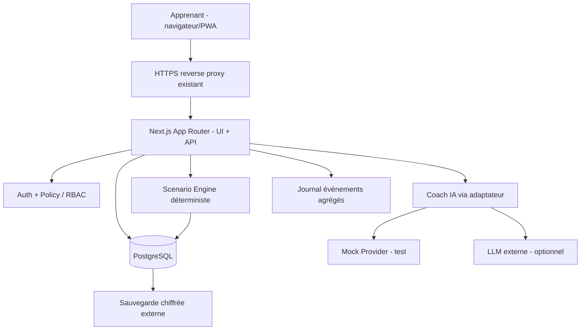

> **Historique — vision abandonnée comme produit principal.** L'architecture courante est [SYSTEM_ARCHITECTURE_V2.md](SYSTEM_ARCHITECTURE_V2.md). Ce document décrit la simulation.

# Architecture technique — Interactive Soft Skills Academy
Version 1.0 — 31/10/2026

## 1. Décision d'architecture

**Monolithe modulaire Next.js** (App Router, TypeScript strict) sur Docker Compose. PostgreSQL pour données applicatives, stockage objet S3-compatible uniquement si médias ajoutés, et fournisseur IA via adaptateur interchangeable. Une seule application runtime : faible charge opérationnelle sur le VPS partagé Ubuntu 16 Go / 8+ vCPU.

Ni Kubernetes, ni microservices, ni Redis, ni moteur vidéo au MVP. Ne pas faire exécuter de code arbitraire apprenant ; le projet concerne les conversations soft skills.



## 2. Stack

| Couche | Choix | Justification |
|---|---|---|
| Front | Next.js App Router + React + TypeScript | UI/PWA/API dans un produit |
| Style | Tailwind + composants accessibles (p.ex. shadcn/ui) | Rapidité et contrôles UX ; versions validées |
| Schema | Zod | Contrats scénarios et sorties IA |
| Persistance | PostgreSQL 16+ (version réellement disponible à vérifier) | Transactions, JSONB, contraintes et évolutivité |
| ORM | Prisma **ou** Drizzle, un seul | Migrations typées, ergonomie |
| Auth | Bibliothèque éprouvée Auth.js ou équivalent | Gestion sessions sécurisées, aucun auth maison |
| IA | AI SDK TypeScript ou client fournisseur encapsulé | Mock, plafonds et substitution |
| Tests | Vitest + Playwright | Unit/contract/integration/E2E |
| Déploiement | Docker Compose + reverse proxy existant | Respect VPS partagé |
| CI/CD | GitHub Actions, SSH deploy contrôlé | Reproductible, checks et rollback |

**Compatibilité** : consulter docs officielles à la date de l'implémentation et verrouiller versions dans lockfile ; ne pas figer au hasard une API qui aurait changé.

## 3. Organisation du dépôt

```text
interactive-soft-skills/
├── src/
│   ├── app/                  # routes (marketing, auth, dashboard, scenario, admin)
│   ├── components/           # UI réutilisable, simulation, feedback, navigation
│   ├── modules/
│   │   ├── scenarios/        # auteur, version, validation du graphe
│   │   ├── simulation/       # state machine pure, choix, replay, outcome
│   │   ├── learning/         # rubriques, progrès, debrief
│   │   ├── ai-coach/         # providers, prompts, schema, guardrails
│   │   ├── identity/         # auth/policies/propriétés utilisateur
│   │   └── analytics/        # événements agrégés / coûts
│   ├── db/                   # ORM, migrations, seed, queries
│   └── lib/                  # config, erreurs, validation, observabilité
├── tests/                    # unit, integration, e2e, fixtures
├── docs/                     # spécification, ADR, runbook, privacy
├── scripts/                  # validation des scénarios, seed, backup/test
├── .cursor/rules/            # règles de développement
├── Dockerfile
├── compose.dev.yml
├── compose.prod.yml
├── .env.example
└── .github/workflows/ci.yml
```

## 4. Modèle de données minimal (conceptuel)

### Identité
- `User(id, email, createdAt, deletedAt, locale)`.
- `Session/Account` selon bibliothèque d'auth choisie.
- `RoleAssignment(userId, role, orgId?)` : seulement user/admin au MVP ; structure extensible pour organisation.

### Contenus versionnés
- `Scenario(id, slug, title, audience, difficulty, status, createdAt)`.
- `ScenarioVersion(id, scenarioId, versionNumber, contentHash, schemaVersion, status, contentJson, publishedAt)`.
- `RubricVersion(id, scenarioVersionId, rubricJson, version)` ou rubriques intégrées dans `contentJson` et hash de version ; documenter le choix.
- Les `nodes` et `choices` peuvent vivre dans JSONB versionné tant que moteur strict Zod ; ne pas multiplier les tables sans nécessité.

### Apprentissage
- `Attempt(id, userId nullable for demo?, anonymousTokenHash?, scenarioVersionId, parentAttemptId?, branchFromEventId?, status, startedAt, completedAt, finalScore?)`.
- `AttemptEvent(id, attemptId, sequence, eventType, nodeId, choiceId?, payloadJson, idempotencyKey, occurredAt)`.
- `Feedback(id, attemptId, eventId?, source enum deterministic/ai, rubricVersion, modelVersion?, promptVersion?, contentJson, createdAt)`.
- `AiUsage(id, userId?, requestType, provider, model, inputTokens?, outputTokens?, estimatedCost?, status, createdAt)` : **pas de texte privé**.
- `AnalyticsEvent(id, anonymousId?, userId?, kind, scenarioId?, createdAt)` : pas de dialogues.

### Contraintes SQL recommandées
- index uniques `(scenarioId, versionNumber)`, `(attemptId, sequence)`, `(attemptId, idempotencyKey)`.
- clés étrangères, accès par propriétaire et transaction pour commit d'événement + transition.
- index composés `attempt(userId, startedAt)` et `scenario(status, slug)`.
- `ScenarioVersion` publiée **immutable** (application + garde DB ou politique stricte en écriture).

## 5. Moteur de simulation

### Contrat scénario (simplifié)
```ts
type Scenario = {
  id: string;
  schemaVersion: number;
  title: string;
  objective: string;
  competencies: Array<{ id: string; label: string; weight: number }>;
  initialNodeId: string;
  nodes: Array<{
    id: string;
    type: 'dialogue' | 'decision' | 'ending';
    speaker?: string;
    text: string;
    choices?: Array<{
      id: string;
      label: string;
      nextNodeId: string;
      evidence: string;
      effects: Record<string, number>;
    }>;
  }>;
};
```

### Méthodes métier pures
- `validateScenario(scenario)` valide schema, poids total, références, atteignabilité, branchements et fins.
- `startAttempt(version)` crée état initial attaché au `contentHash`.
- `getAvailableChoices(state)` interdit choix hors nœud.
- `applyChoice(state, choiceId, eventId)` renvoie nouvel état, événement et contributions sans I/O ; idempotence persistance au niveau service.
- `replayFrom(attempt, eventSequence)` crée **une nouvelle** tentative enfant avec préfixe d'événements logiques et nouveau suffixe ; l'original reste inchangé.
- `computeFeedback(events, rubric)` restitue résultats reproductibles ; ne pas faire calculer score canonical par IA.
- Les cycles doivent être explicites et bornés (`maxVisits`), mais **aucun** cycle dans scénario pilote.

### Machine à états
`draft -> in_progress -> completed` ou `abandoned`. `replay` est un événement qui **crée une tentative distincte**, pas un retour en arrière destructif.

### API versionnée (exemple)
```
GET    /api/v1/scenarios
GET    /api/v1/scenarios/:slug
POST   /api/v1/attempts                  {scenarioVersionId}
GET    /api/v1/attempts/:id
POST   /api/v1/attempts/:id/choices       {nodeId, choiceId, idempotencyKey}
POST   /api/v1/attempts/:id/replay        {fromSequence}
GET    /api/v1/attempts/:id/debrief
POST   /api/v1/attempts/:id/coach        {eventId?, question, freeText?}
GET    /api/v1/me/export
DELETE /api/v1/me
```

Toutes les routes privées vérifient la session et l'appartenance côté serveur. Limiter la taille des payloads. API REST indicative, à adapter au routing retenu.

## 6. Stratégie IA : guidée, explicable, remplaçable

### Entrées autorisées
Objectif du nœud, contexte scénaristique validé, critères de la rubrique, décision active et texte pertinent de **l'utilisateur courant**. Ne jamais fournir d'autres tentatives, de dossiers d'entreprise ou de données sensibles non nécessaires.

### Sortie validée
```ts
const CoachOutputSchema = z.object({
  summary: z.string().max(500),
  strengths: z.array(z.object({ competencyId: z.string(), evidence: z.string(), comment: z.string() })).max(3),
  improvements: z.array(z.object({ competencyId: z.string(), evidence: z.string(), suggestion: z.string() })).max(3),
  alternativeReply: z.string().max(500),
  reflectionQuestion: z.string().max(300),
  uncertain: z.boolean(),
});
```

**Interdits** : altérer `nextNodeId`, changer `rubric.weight`, écrire directement dans `AttemptEvent`, inventer règles RH ; diagnostiquer un trouble ; proposer classification de personnalité ; évaluer l'employabilité.

### Dégradation et garde-fous
- `MockAiCoach` par défaut ; `RealAiCoach` activé si clé et feature flag.
- Timeouts, retries bornés seulement si pertinents, rate limit et budget maximum de dépenses configurables.
- Cache possible pour débriefings génériques, **jamais** sur réponse privée inter-utilisateurs.
- Prompts versionnés en fichiers, auditables ; sorties échappées/sanitized.
- Défense contre prompt injection : séparer texte utilisateur et instructions système, valider contextes, pas de tools dangereux, aucune clé exposée ; tests d'attaque automatisés.
- Traces et métriques sans réponse brute par défaut. Si besoin de traces de qualité : opt-in explicite, durée de vie limitée, suppression possible.

## 7. UX et design system

Palette neutre + accent unique ; disposition très lisible inspirée d'un cockpit pédagogique, non d'un outil RH. Composants : AppShell, Sidebar, ScenarioCard, BriefingPanel, DialogueTimeline, DecisionPanel, CoachPanel, ProgressTracker, DebriefBreakdown, ReplayTimeline, AccessibilityControls.

Desktop : sidebar 240px + zone contenu centrée max ~1200px. Mobile : navigation simplifiée, actions accessibles en bas de scène, dialogues lisibles. Texte du feedback toujours vérifiable par rapport à une décision visible. i18n : ressources texte séparées et `locale` utilisateur.

## 8. Sécurité, confidentialité, réglementation

- TLS via reverse proxy existant ; PostgreSQL **jamais** exposé publiquement, réseau privé Docker.
- Secrets via variables d'environnement / secrets management ; aucune clé LLM au navigateur ; MFA administrateur si possible.
- Cookies `Secure`, `HttpOnly`, `SameSite` adaptés ; anti-CSRF selon bibliothèque, sécurité headers/CSP.
- RBAC & ownership sur **chaque accès API et query DB** ; contrôles côté serveur, pas seulement masquage UI.
- Limitation par IP/compte, validation Zod des inputs, taille max, escaping, préparation SQL.
- Politique de rétention concrète (p.ex. tentatives jusqu'à suppression utilisateur ; données démo courtes) validée avant prod.
- Notice « vous parlez à une IA » et indication des prestataires externes, transferts, options de confidentialité.
- RGPD/LPD à examiner selon zones ciblées, DPA prestataires, base juridique et droits des personnes.
- IMPORTANT : éviter dans MVP les usages d'évaluation réelle des collaborateurs/candidats ; l'annexe III de l'AI Act inclut certains usages en emploi **et** en éducation/formation professionnelle. Avis juridique spécialisé avant contrats B2B et certifications.

## 9. Déploiement VPS partagé

### Infrastructure recommandée
- Utiliser le reverse proxy déjà en place et un sous-domaine à choisir, p.ex. `academy.<domaine>` uniquement après validation.
- Réseau Docker privé propre à l'application ; seul le proxy rejoint le réseau de l'app, port DB non publié.
- Réutiliser un cluster PostgreSQL **existant** si déjà administré, avec base et rôle isolés ; sinon conteneur Postgres dédié.
- Volumes persistants pour DB, secrets distincts dev/staging/prod.
- Stockage média externe si audio généré plus tard.

### Enveloppe de ressources de départ (hypothèse à mesurer)
- App Next.js : plafond ~1 à 1,5 Go RAM, ~1 vCPU.
- Base Postgres dédiée, si nécessaire : plafond ~0,75 à 1,5 Go RAM, ~1 vCPU.
- Le déploiement CI construit l'image **hors VPS** via GitHub Actions ; sur VPS seulement pull + migration + restart + healthcheck.
- Désactiver build et exécution IA lourde en local sur le VPS.
- Mesurer mémoire du VPS **avant** allocation, préserver une réserve pour les autres applications.
- Aucune métrique de capacité ferme avant test de charge et inventaire de l'hôte.

### Backups et recovery
- Sauvegarde PostgreSQL automatique quotidienne, chiffrée et **externalisée** (hors VPS).
- Conserver plusieurs points de restauration (politique à définir), tester réellement une restauration avant prod puis périodiquement.
- Runbook rollback DB : migrations réversibles ou stratégie forward fix documentée, snapshots avant changements destructifs.

### CI/CD
1. Push/PR GitHub → installation lockfile → lint → TS → unit → integration → E2E smoke → build → scan dépendances.
2. Merge `main` → build image versionnée et push registry.
3. Déploiement contrôlé sur serveur : pull, sauvegarde si migration risquée, migrate, healthcheck, bascule/rétablissement.
4. PR sans secret, restrictions d'approbation, branche protégée.

## 10. Tests de sécurité/qualité prioritaires

- IDOR : autre compte et une URL devinée → 403/404 sans données.
- Auth : token expiré/révoqué ; admin non autorisé ; delete/export du bon compte.
- Scénario : transitions invalides et données malformées refusées ; scénario publié immutable.
- Replay : état original intact ; scores recalculés stables.
- Concurrence : double clic ou appels simultanés idempotents.
- IA : injection de « ignore previous instructions », contournement quotas, JSON invalide, absence de provider, timeout.
- Données : tests effacement/backup, aucune PII en logs.
- WCAG : navigation clavier / labels / contrastes / annonces aria.
- Failures : DB indisponible et IA indisponible avec message utile ; aucune corruption de tentative.

## 11. ADR initiales (décisions d'architecture)

- ADR-001 : Monolithe modulaire et non microservices, pour réduire maintenance.
- ADR-002 : Graphe scénaristique et scores déterministes ; LLM limité à feedback formatif.
- ADR-003 : Révisions de scénario immuables ; une tentative est épinglée à une version.
- ADR-004 : Pas de voix/vidéo ni marketplace avant validation marché.
- ADR-005 : Démo sans fournisseur LLM (mock) et sans backend tiers indispensable.
- ADR-006 : Données personnelles privées ; pas de scoring RH ou distribution automatique aux employeurs.
